<div align="center">


# MyMusic

**A music player that learns what you like.**
Recommendations, mood mixes, a 3D glass design, an admin studio for publishing songs, and an installable app. It runs entirely on Firebase's free plan.

**[▶ Open the live app](https://mymusic-stream.web.app)** · [Studio (admin)](https://mymusic-stream.web.app/admin)

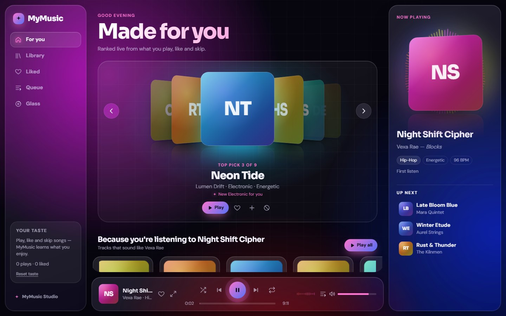

</div>

## Contents

- [Screenshots](#screenshots)
- [Features](#features)
- [How it works](#how-it-works) (flowcharts)
  - [System overview](#system-overview)
  - [Recommendation engine](#recommendation-engine)
  - [Playing a song](#playing-a-song)
  - [Publishing a song](#publishing-a-song)
  - [Admin access](#admin-access)
- [MyMusic Studio](#mymusic-studio)
- [Tech stack and project structure](#tech-stack-and-project-structure)
- [Getting started](#getting-started)
- [Deploying](#deploying)
- [Free-plan limits](#free-plan-limits)

## Screenshots

| | |
| --- | --- |
| 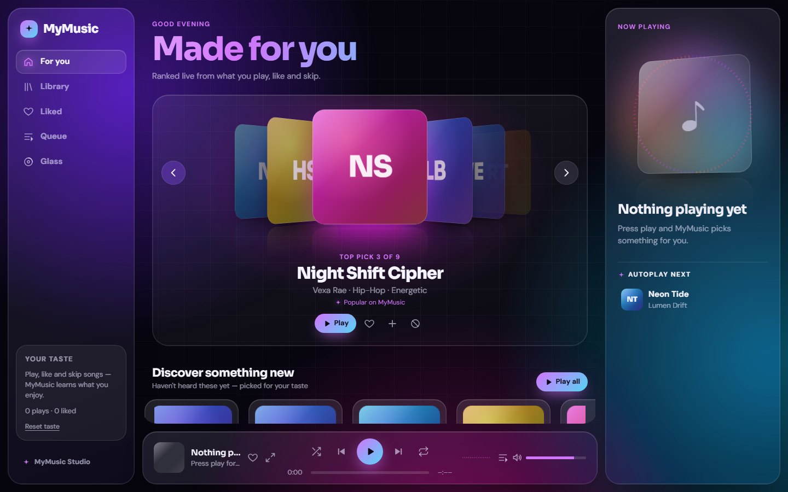 | 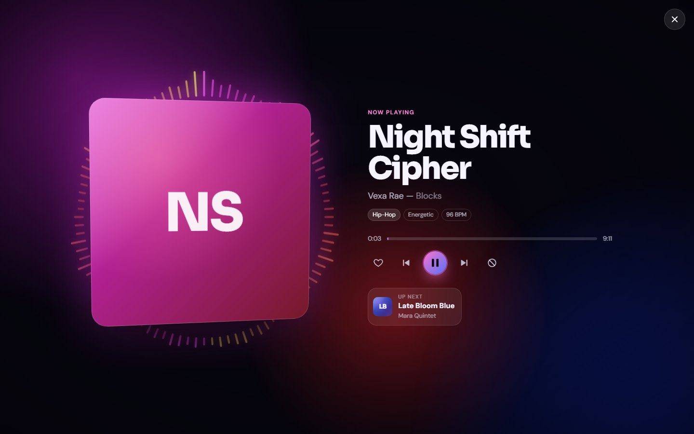 |
| **Home (Glass).** A 3D coverflow of your top picks, with the reason each was picked. | **Full-screen player.** The 3D cover tilts with your mouse, inside a beat-synced ring visualizer. |
| 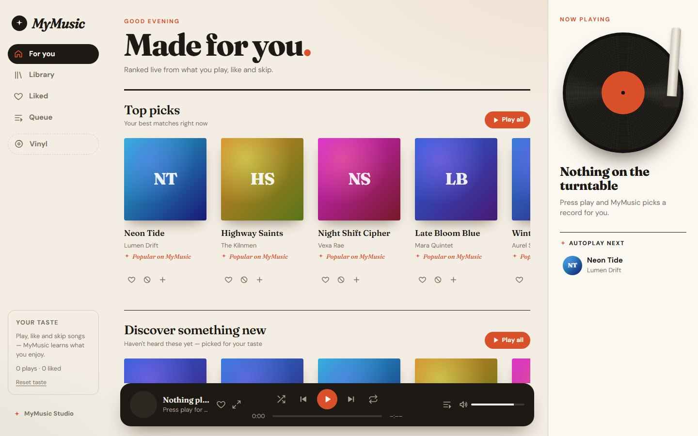 | 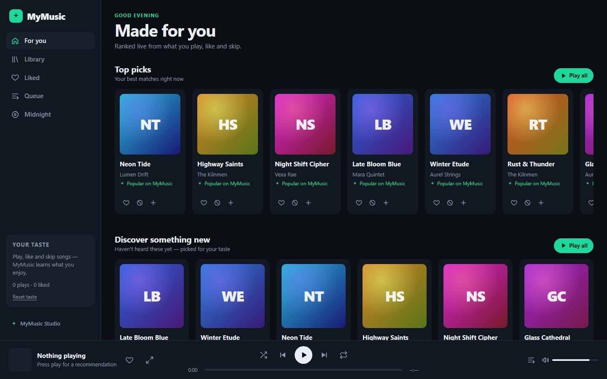 |
| **Vinyl design.** Warm paper colours, a spinning record and a tonearm. | **Midnight design.** The classic dark streaming-app style. |
| 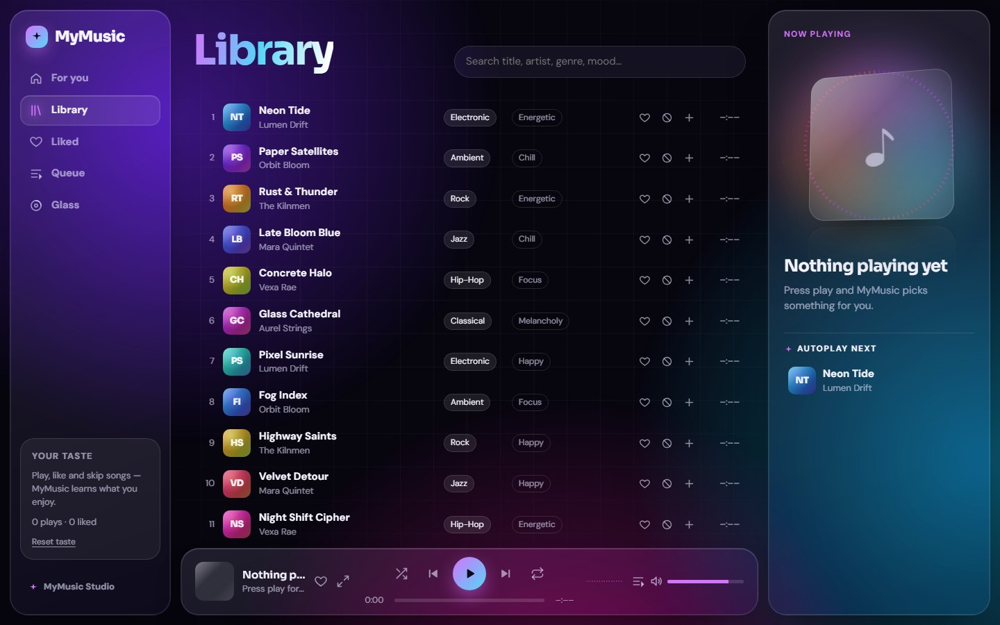 | 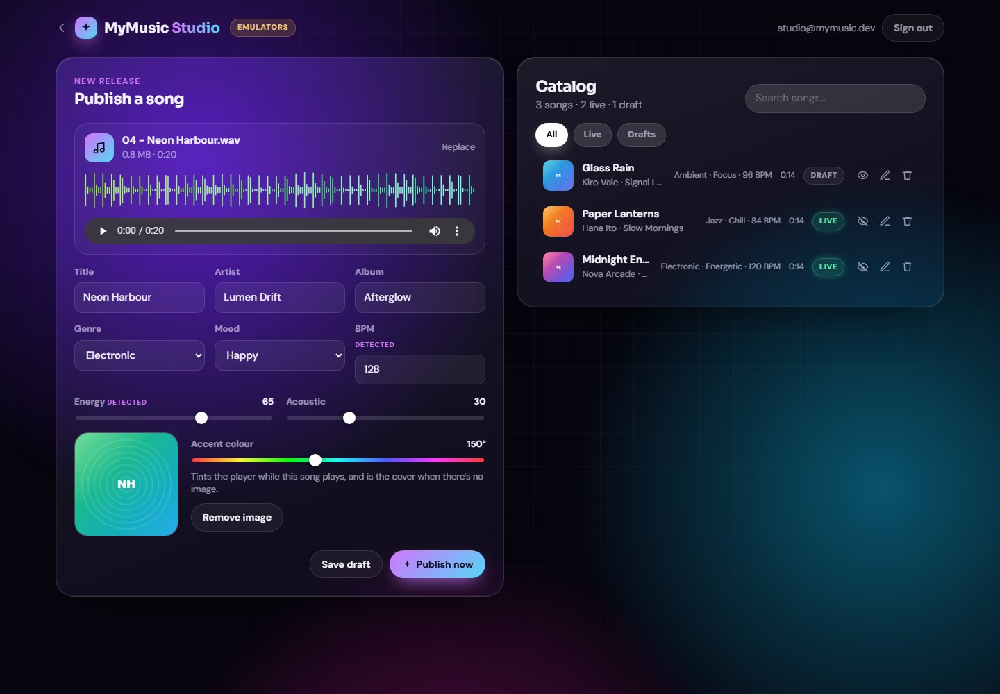 |
| **Library.** Search, genre and mood tags, like / not-for-me / queue. | **Studio (admin).** Upload with automatic BPM, energy and waveform detection, then publish or save as a draft. |

<p align="center">
  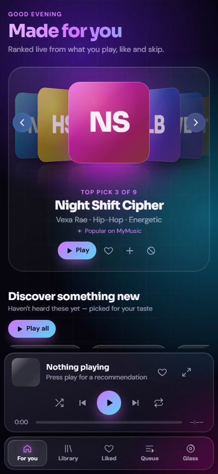
  &nbsp;&nbsp;
  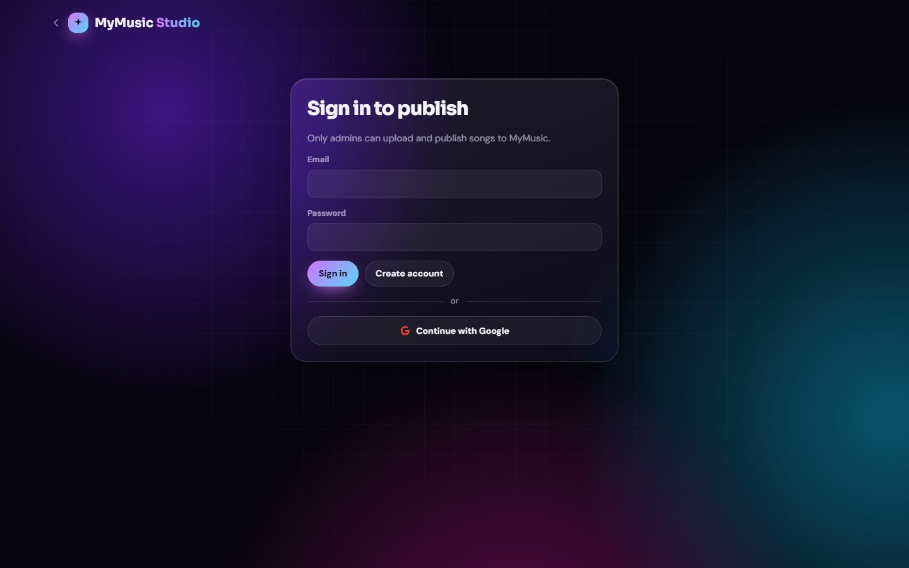
</p>

> The Studio screenshot was taken on the local Firebase emulators (hence the *Emulators* badge) with sample songs.

## Features

**Listening**
- Play, pause, next, previous, seek, volume, shuffle, repeat (all / one) and a queue you can edit.
- **Recommendations that explain themselves**: *Top picks*, *Because you're listening to…*, *Discover something new*, *Mood mixes* and *Jump back in*. Every pick shows why it was chosen, for example "Because you liked Paper Satellites".
- **Autoplay** continues with recommendations when the queue runs out.
- **Learns from you**: likes, full plays, skips and "Not for me". A *Your taste* panel shows your genre affinity.
- **Full-screen player** with a 3D tilting cover and a ring visualizer. `Esc` closes it.
- Keyboard shortcuts: `Space` play/pause · `←/→` seek 5 s · `Shift+←/→` previous/next · `L` like.

**Design**
- **Three designs**, switched with the *Theme* button:
  - **Glass** (default): frosted panels over an aurora background tinted by the current song, cards that tilt in 3D with glare, a 3D coverflow, beat-synced glow and a cursor spotlight.
  - **Vinyl**: paper and serif styling with a turntable panel.
  - **Midnight**: classic dark.
- Responsive from phones to wide screens. All motion turns off when the system's *reduce motion* setting is on.

**App**
- **Installable (PWA)**: an *Install app* button appears in Chrome, Edge and Android. On iPhone it explains *Share → Add to Home Screen*.
- The installed app opens in its own window, has Library and Liked shortcuts, and opens offline.
- **Lock-screen and media-key controls** through the Media Session API.

**Publishing**
- **MyMusic Studio** (`/admin`): admins upload, publish, edit, unpublish and delete songs. See [MyMusic Studio](#mymusic-studio).

## How it works

The diagrams below are [Mermaid](https://mermaid.js.org) flowcharts. GitHub renders them automatically.

### System overview

The player and Studio are two pages of one static site on Firebase Hosting. All shared data lives in Firestore. Each listener's taste profile stays in their own browser.

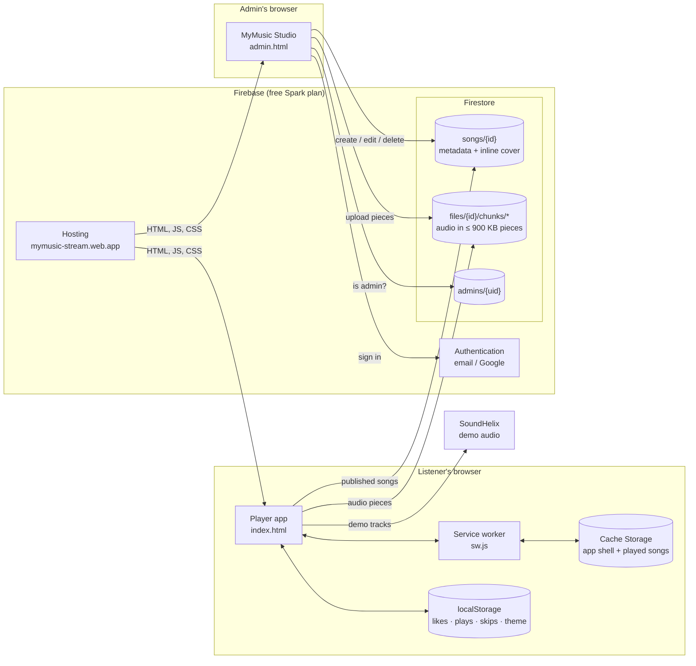

### Recommendation engine

Content-based filtering, all in the browser ([src/recommender.ts](src/recommender.ts)). No listening data ever leaves the device.

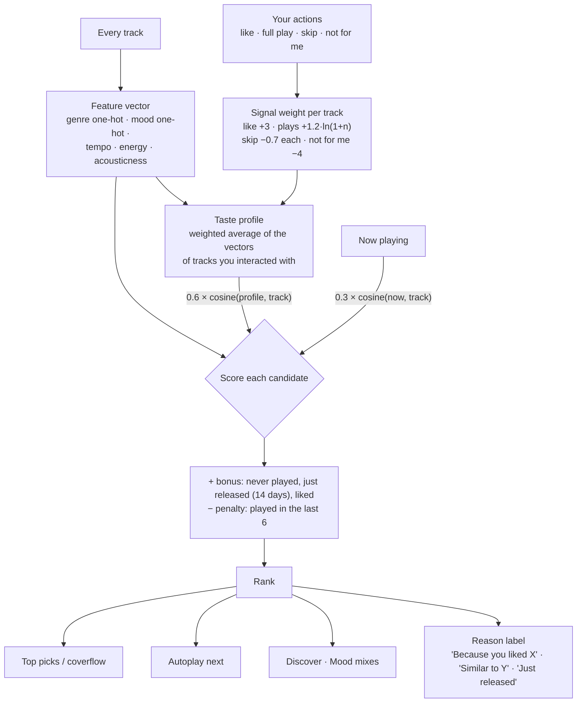

| Signal | Weight | When it counts |
| --- | --- | --- |
| Like | +3 | Heart button or `L` |
| Full play | +1.2 × ln(1 + plays) | After 30 s, or half the track if shorter |
| Skip | −0.7 each (max 5) | Next pressed before a play counted |
| Not for me | −4 | Also hides the track from recommendations |

### Playing a song

Demo songs stream from a URL. Songs published from Studio are stored in Firestore pieces, put back together in the browser, and cached so replays are free.

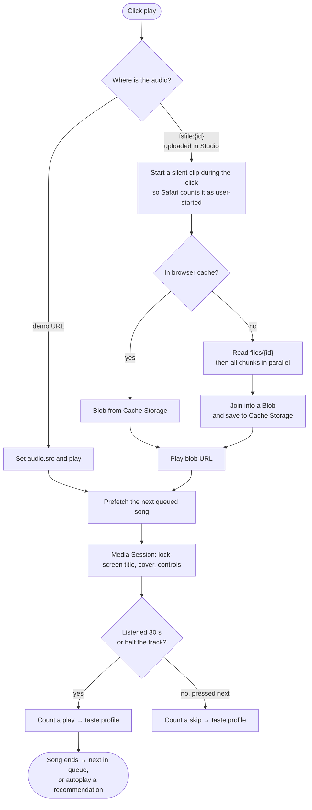

### Publishing a song

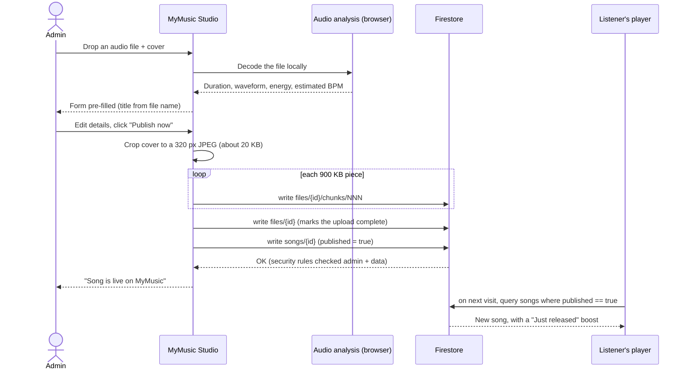

If a save fails partway, Studio deletes the pieces it already uploaded, so no orphaned files are left behind.

### Admin access

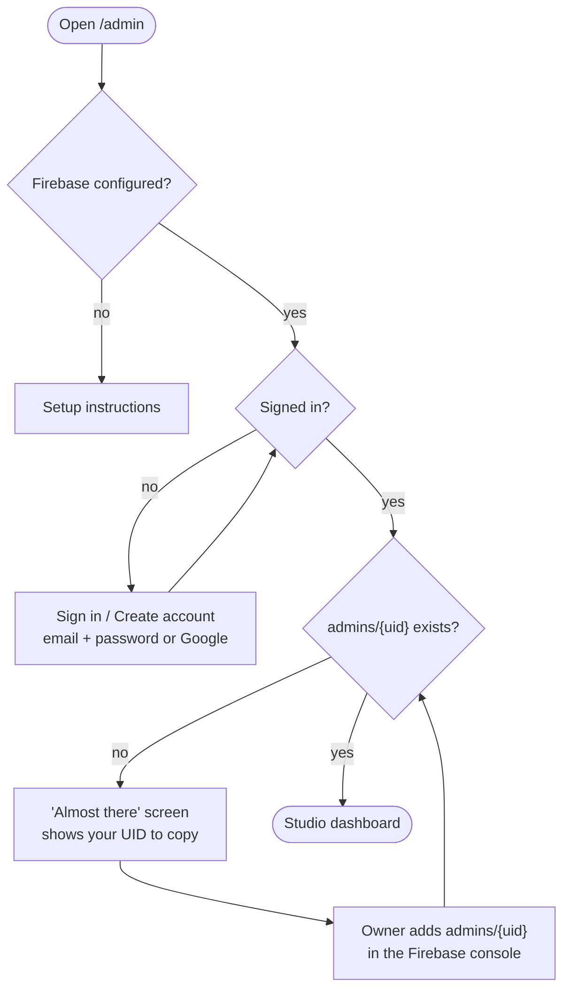

Nobody can grant admin from the app itself. The rules deny every client write to `admins/`.

## MyMusic Studio

`/admin` is where admins manage the catalog. Published songs appear in the player for everyone, ahead of the demo songs.

**Publishing**
- Drop an audio file (MP3, M4A, OGG or WAV, up to 15 MB). The browser fills in the **duration**, **waveform**, **energy** (from loudness) and an **estimated BPM**. You can change any of them.
- Add the title, artist, album, genre, mood, an optional **cover** (cropped and shrunk automatically) and an **accent colour**, which tints the player while the song plays.
- **Publish now** or **Save draft**. Drafts are visible only to admins.
- From the catalog: search, filter (All / Live / Drafts), publish/unpublish, edit (including replacing the audio or cover) and delete. Deleting removes the audio too.

**Data model**

| Where | What |
| --- | --- |
| `songs/{id}` | Metadata, `published` flag, cover as a small inline JPEG |
| `files/{id}` + `files/{id}/chunks/000…` | Audio split into ≤ 900 KB pieces |
| `admins/{uid}` | Marks a user as an admin (added by hand in the console) |

**Security rules** ([firestore.rules](firestore.rules))
- Anyone can read **published** songs. Drafts and all writes are for admins only.
- Song data is validated: allowed genres and moods, BPM 40–220, values in range, cover under 200 KB.
- Audio pieces can only be written by admins, must be ≤ 900 KB, can't be overwritten, and can't be listed (only fetched by exact ID), so draft audio can't be found.

## Tech stack and project structure

**TypeScript** · **Vite** (no UI framework) · **Firebase**: Hosting, Authentication and Firestore · Web Audio API · Media Session API · Service Worker / PWA · Mermaid (docs)

```
├── index.html               Player page
├── admin.html               Studio page
├── src/
│   ├── main.ts              Boot: load songs, create player + UI
│   ├── ui.ts                Player UI: views, coverflow, full-screen player, themes
│   ├── player.ts            Playback, queue, shuffle/repeat, play/skip detection
│   ├── recommender.ts       Taste profile + recommendation ranking
│   ├── visualizer.ts        Tempo-synced ring and bar visualizers
│   ├── store.ts             localStorage: stats, history, theme, volume
│   ├── catalog.ts           Demo songs + genre/mood labels
│   ├── songs.ts             Firestore songs: fetch, create, update, delete
│   ├── filestore.ts         Audio in Firestore chunks: upload, play, cache
│   ├── firebase.ts          Firebase setup (+ emulator switch)
│   ├── pwa.ts               Install prompt, service worker, Media Session
│   ├── style.css            All three designs
│   └── admin/
│       ├── main.ts          MyMusic Studio
│       ├── analyze.ts       In-browser BPM / energy / waveform detection
│       └── admin.css
├── public/
│   ├── sw.js                Service worker (offline app shell)
│   ├── manifest.webmanifest PWA manifest
│   └── icons/               App icons + install screenshots
├── firestore.rules          Security rules
├── firebase.json            Hosting (2 sites), headers, emulators
└── docs/screenshots/        Images used in this README
```

## Getting started

```bash
npm install
npm run dev              # player at http://localhost:5173 (demo songs, no Firebase needed)
npm run build            # type-check + production build to dist/
```

**Try Studio locally with no Firebase project:**

```bash
npm run emulators        # Auth + Firestore emulators, console at http://127.0.0.1:4000
npm run dev:emulator     # second terminal → http://localhost:5173/admin.html
```

Create an account in Studio, then make it an admin in the emulator console at http://127.0.0.1:4000/firestore: add an `admins/<your UID>` document. Emulator data resets on restart.

**Connect your own Firebase project (one time):**

1. Create a project. The free **Spark** plan is enough.
2. Enable **Authentication** (Email/Password, and Google if you want it) and create a **Firestore** database.
3. Add a **Web app**, copy `.env.example` to `.env.local` and fill in the values.
4. Put your project ID in `.firebaserc`.
5. Run `npm run deploy:all`.
6. Open `/admin`, create your account, and add `admins/<your UID>` in the console.
7. If you use Google sign-in on a custom domain, add the domain under **Authentication → Settings → Authorized domains**.

Set `VITE_INCLUDE_DEMO_SONGS=false` in `.env.local` to hide the demo songs once you have your own.

## Deploying

```bash
npm run deploy           # build + hosting
npm run deploy:all       # build + hosting + Firestore security rules
```

Hosting serves two sites from `dist/`. `mymusic-stream.web.app` is the app. The project's original `pulse-music-xyg4.web.app` address permanently redirects to it. Pages are served with `no-cache` so updates show up immediately, while fingerprinted `/assets/*` files are cached for a year.

## Free-plan limits

Everything runs on Firebase's free Spark plan. Firestore's allowance is the ceiling:

| Free limit | Means roughly |
| --- | --- |
| 1 GiB stored | 150–200 songs of about 5 MB |
| 10 GiB downloaded per month | about 2,000 plays a month. Replays in the same browser are cached and free. |
| 50,000 reads per day | plenty. A 5 MB song is about 6 reads. |

A Studio song downloads fully before it starts (1–2 s on normal internet), and the next song in the queue is fetched ahead of time. Upload MP3s rather than WAVs: about 1 MB per minute instead of about 10. If you outgrow the free plan, only [src/filestore.ts](src/filestore.ts) needs to change to use Cloud Storage or another file host.

**About the visualizers:** the demo audio host doesn't allow the browser to read its samples (no CORS headers), so the visualizers are generated from each song's BPM and energy, synced to the playback clock. Studio audio is analysed for real at upload time, to detect BPM and energy.

---

Demo audio: [SoundHelix](https://www.soundhelix.com) example songs. Demo titles and artists are fictional.
